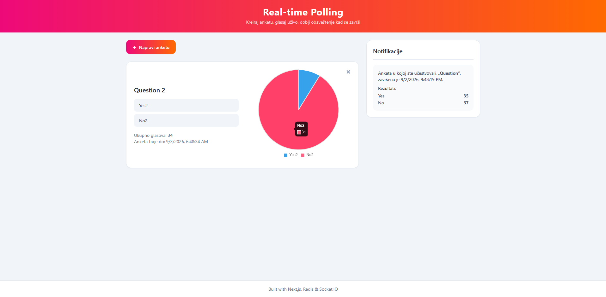
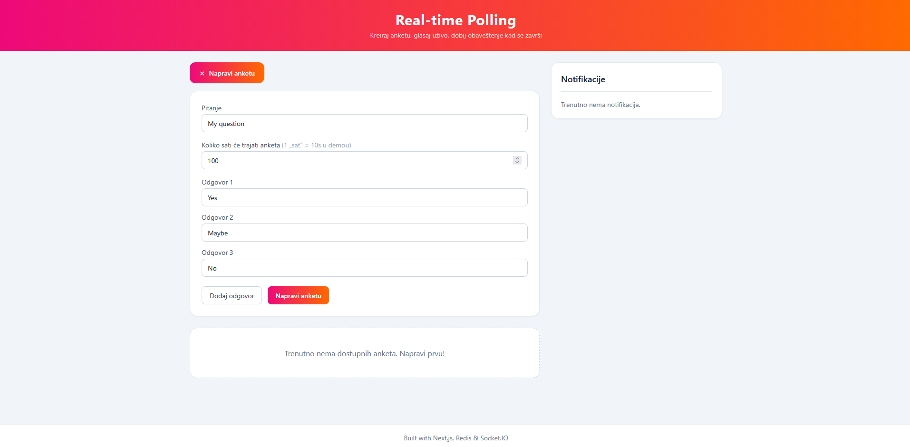

# Real-time Polling

A web application for creating and sharing polls in real time. Users create
polls, vote live, and get a notification when a poll expires — poll expiration
is detected through **Redis keyspace notifications (Pub/Sub)**, and the result
is pushed to all connected clients over **Socket.IO**.

**Live demo:** https://nbp-redis.vercel.app

---

## Features

- Creating a poll with an arbitrary number of options and a duration
- Live voting — results update without refreshing the page
- Results shown as a pie chart (Chart.js)
- Automatic notification to participants when a poll expires (Redis Pub/Sub → Socket.IO)
- Deleting your own polls
- User identification via a cookie (no registration)

## Technologies

| Layer     | Technology                                              |
| --------- | ------------------------------------------------------- |
| Frontend  | React 18, Next.js 14 (App Router), Tailwind CSS         |
| Backend   | Next.js Server Actions                                  |
| Real-time | Socket.IO (separate Node.js server)                     |
| Database  | Redis Cloud (Hash structures + `EXPIRE` + keyspace events) |
| Deploy    | Vercel (Next app) + Render (socket server)              |

## Architecture

The application has two processes:

- **Next.js app** (`src/`) — UI and Server Actions that read from / write to Redis.
- **Socket server** (`socket-server/`) — a permanently open WebSocket connection +
  Redis `subscribe` on `__keyevent@0__:expired`. When a poll expires, the server
  emits `serverEvent` to all clients.

A separate process is required because Vercel is serverless and cannot hold a
persistent WebSocket connection or a Redis `subscribe`.

## Screenshots

### Home page



### Creating a poll



## Running locally

```bash
# 1. Install dependencies (root + socket server)
npm install
cd socket-server && npm install && cd ..

# 2. Create .env.local (see .env.example) and fill in REDIS_URL

# 3. Run both processes at once
npm run dev:all
```

App: [http://localhost:3000](http://localhost:3000) · Socket server: `http://localhost:3001`

Alternatively, in two terminals: `npm run dev` and `npm run dev:socket`.

### Environment variables

| Variable                 | Description                                            |
| ------------------------ | ----------------------------------------------------- |
| `REDIS_URL`              | Connection string to the Redis database (Redis Cloud → Connect) |
| `NEXT_PUBLIC_SOCKET_URL` | URL of the Socket.IO server (locally `http://localhost:3001`) |

## Notes

- For easier testing, every "hour" of a poll's duration actually lasts **10 seconds**.
- After creation, a poll shows random votes — purely to demonstrate how the pie
  chart looks. It does not affect the application's technical logic.
